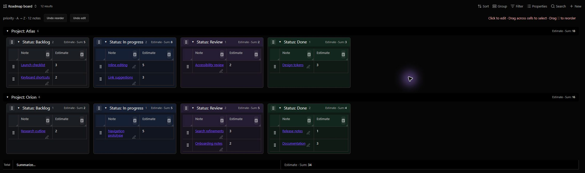
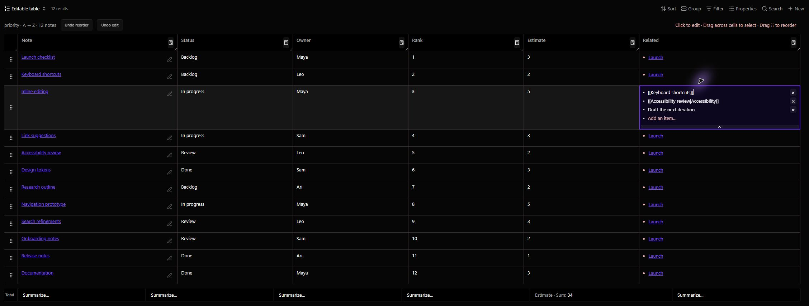
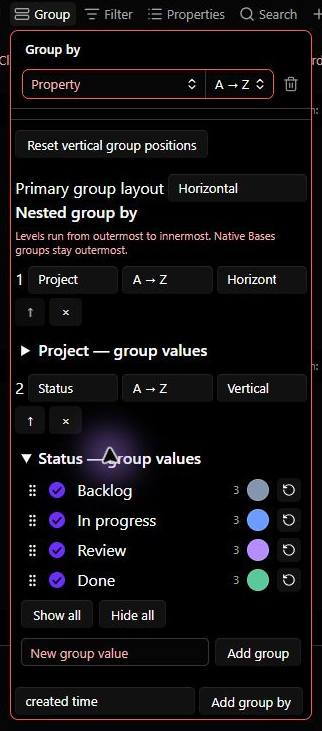

# NosyGrid

**Editable tables and board columns for Obsidian Bases, with manual row ordering.**

Organize notes in a grid, drag rows between groups, edit their properties in place, and combine horizontal sections with vertical columns. Note data stays in note properties; layout and optional per-view ordering stay in the Base view.



*Real captures from Obsidian 1.15.0 on Windows, using the included fictional [example notes and Base](docs/examples). Images are cropped, with no replacement UI. Appearance reflects the capture vault’s theme and settings. See [capture details](docs/images/README.md).*

## Features

- **Manual row ordering.** Drag a handle to reorder notes. Choose note-property ranks or independent Base-view ranks. Fractional allocation preserves unchanged ranks whenever there is space.
- **Inline editing.** Edit text, numbers, dates, checkboxes, lists and structured values. Rename files from the file-name cell. Ordinary edits update changed cells without rebuilding the table.
- **Links and lists.** Complete `[[wiki links]]` as you type, use aliases and native link interactions, drag links into other cells, and add or remove list items.
- **Selection and clipboard.** Drag across cells to select a range; copy complete values or paste into selected cells. Ctrl/Cmd-click row handles to toggle rows, and Shift-click to select a row range.
- **Nested grouping.** Choose horizontal or vertical layout per grouping level. Matching vertical columns stay aligned across horizontal sections, even when empty.
- **Move notes between groups.** Drag one row or a selected block into another group to update its properties. A floating preview follows the cursor; shadow placeholders mark the source positions. Cancelled or invalid drops restore the rows.
- **Saved layout and colors.** Resize, collapse, hide and reorder columns. Assign a color to each group value. View settings persist in the Base.
- **Native summaries.** Choose a summary per property and see it in each group and in the overall total. Built-ins use Obsidian's summary engine; existing custom summaries can be selected by name.
- **Undo.** Separate commands restore the last row reorder or cell/group edit, with checks for conflicting changes.

## Install

Declares a minimum of **Obsidian 1.10.2** and the **Bases** core plugin. The plugin has not yet been approved for the Community plugins directory.

### Manual installation

1. Download `main.js`, `manifest.json`, and `styles.css` from the [latest release](https://github.com/JanB987/NosyGrid/releases/latest).
2. Put all three files in `<your-vault>/.obsidian/plugins/nosygrid/`.
3. Restart Obsidian and enable **NosyGrid** under **Settings → Community plugins**.

Only install plugins from sources you trust. Back up your vault before trying a plugin that writes properties.

### Build from source

With Node.js 24 or newer:

```sh
npm ci
npm run lint
npm run typecheck
npm test
npm run build
```

Copy the three files from `dist/` to the plugin folder above. On Windows, you can also run:

```powershell
./install.ps1 -VaultPath "C:/path/to/your/vault"
```

Browser checks run when Chrome/Edge is available on Windows, or when `OBSIDIAN_TEST_BROWSER` points to a Chromium executable. CI installs Chromium and runs those checks too.

## Quick start

1. Open or create a Base and choose **NosyGrid** as its view layout.
2. Choose **Order storage**: **Note property** (the existing default) or **Base view**. Select **A → Z** or **Z → A** and **Maximum decimal places** (0–6, default 2). Note-property mode requires a numeric **Ordering property**, such as `priority`.
3. Use the Bases **Properties** and **Filter** controls to choose columns and notes.
4. Drag a row handle to change its position, or click a cell to edit its property.
5. Open **Group** to add grouping levels. Choose **Horizontal** for sections or **Vertical** for board columns.
6. Expand **[property] — group values** to choose colors. Add or remove note-property values in either orientation; vertical groups also offer show/hide and reordering.
7. Click a column's calculator icon, or right-click its header, to choose a summary.

For example, moving Note C between Note A (`1`) and Note B (`2`) assigns Note C `1.5` and leaves both neighbours unchanged. Moving above the first row or below the last assigns a rank beyond that boundary; zero and negative ranks are valid.

**Maximum decimal places** controls new ranks rather than display formatting: `1` stays `1`, not `1.00`. Changing the setting does not rewrite existing notes, including values with greater precision. Multi-row drops distribute new ranks inside the available gap. When there are too few representable values, NosyGrid rebalances the smallest surrounding range that can fit the moved block; distant ranks stay unchanged. Zero decimal places allows integer ranks only. Decimal allocation uses exact integer units and checks that the resulting JavaScript numbers remain distinct.

Empty ranks sort after numbered ranks; text ranks such as `high` or `"1"` do not enable manual ordering. Drops on a group header change membership while preserving ranks; positioned row drops also allocate ranks in the destination group. Undo restores the original values.

## Where ordering is stored

**Note property** writes ranks into the selected frontmatter property so other views, queries and plugins can use them. Reordering now fresh-reads only changed notes and their surrounding anchors instead of reading the whole group.

**Base view** stores a path-to-rank mapping in that view’s configuration. Pure row reorders read and write no Markdown files, update the existing table immediately, and save one configuration update. Each view can have its own order. Before the first saved move, existing numeric ordering-property values seed the order; text values are ignored. Afterward, new query results appear after ranked notes until positioned manually. Filtered-out notes retain their saved ranks. Switching modes preserves both sets of values and does not copy ranks back to notes.

Group membership changes still edit the corresponding note properties. Positioned group moves save the per-view ranks and membership changes as one undoable action. Renames are tracked while the view is open; if a note is renamed while its Base view is closed, it is treated as a new result when that view reopens. Deleted-file ranks are removed on the next saved reorder. Ordinary note-property cells continue to show and edit the real note values, independently of view ranks. View ranks are not available to native tables, formulas, filters or other plugins; native query filters/limits still determine which notes NosyGrid receives.

## Try the screenshot examples

Copy the contents of [docs/examples](docs/examples) into a folder named **Screenshot Demo** in a test vault. Open **NosyGrid Examples.base**, then choose **Roadmap board** or **Editable table**. The filter requires that folder name and `demo: true`; the twelve notes are fictional and their estimates sum to 34.

## Edit notes in place

Click a cell to edit it. Enter saves; Tab saves and advances; Escape cancels an uncommitted edit. List cells provide an item editor, removal controls and a blank row for new entries. Long lists can expand the row, and the expanded height is saved in the view.



Type `[[` to search for links. Click rendered links normally, use Ctrl/Cmd-click or middle-click for another pane, or hover for previews when Obsidian's Page preview behavior allows it. Drag links between compatible text/list cells to append them.

Drag across cells to select a range. **Ctrl/Cmd+C** copies full values, including hidden list items. **Ctrl/Cmd+V** replaces selected cells; a single list cell can receive several clipboard lines as list items.

## Groups, columns and dragging

Grouping levels run from outermost to innermost. Each level can be horizontal or vertical; an existing native Bases group stays outermost. Matching columns across horizontal sections share a width and position. Group values encountered in the view are saved in its catalogue and stay available when empty, even if no vault note uses them anymore. Empty visible columns stay available as drop targets.

Drag the right edge to resize a column. Click its header to collapse it to a rail. Drag a group-header grip to reposition columns; drag a row grip to move notes. These are separate actions.

In **Group → [property] — group values**, use **Add group** to create an unused value or **Add empty group** for an unset property. The trash icon removes a value from this view’s catalogue and display. It does not delete notes or change their properties; notes matching a removed value stop appearing in this view. Removal survives refresh and reopening, even while notes still use the value. Add the same value again to restore it. Hiding a column remains a separate, reversible visibility setting. Grouping-level creation is labelled **Add group by**.



A row becomes selected as soon as you press its handle. Dragging past the normal movement threshold lifts the selected rows into a preview. **Ctrl/Cmd-click** toggles individual rows; **Shift-click** selects the visible range from the anchor. Dragging a selected handle preserves the block. Clicking a cell or empty space clears row selection and starts the next action.

Dropping into a group assigns the destination's grouping values, including its ancestors. A positioned drop also updates numeric ranks in the destination. Empty groups accept rows. Releasing outside a recognized destination, pressing Escape or cancelling the drag restores the originals without a write.

## Summaries

Click a column's calculator icon or right-click its header. Numeric properties offer Sum, Average, Min, Max, Median, Range and Stddev. All types offer Empty, Filled and Unique; dates and checkboxes have their native functions.

Summaries appear in group headers, including collapsed groups, and in a **Total** row below the view. Totals exclude hidden groups, include collapsed groups, and count each visible note once. Choose **None** to remove a summary. Summary persistence currently uses capability-checked Obsidian core accessors that are absent from the public SDK declarations. Custom formulas must already be defined in the Base; **Use custom summary…** selects one by name.

## What gets saved

- **Note properties:** edited values, numeric ranks, and grouping values changed by a move.
- **File paths:** explicit file-name, folder or path edits.
- **Base view:** grouping, colors, row heights, column widths, collapsed/hidden values, manual group order, summary choices and ranks when Base-view ordering is selected.

Opening a view does not normalize note data. Reordering affects the current leaf group and query results, not notes excluded by a filter or limit. Hidden notes can retain duplicate ranks. Undo history lasts for the current plugin session and is separate from Obsidian's text-editor undo.

Formula and computed file properties are read-only. A layout rebuild is still needed when files enter or leave the query, grouping changes, files are renamed or columns change. Automated desktop interaction tests use mock Obsidian APIs. The documentation examples were also checked in Obsidian 1.15.0 on Windows; this is not a full compatibility test of every feature, theme or Obsidian version. Mobile touch dragging has not been validated.

## Development and releases

- `npm run build` produces the three distributable files in `dist/`.
- `npm run screenshots:demo` creates mock-browser development images in `test-build/demo-images/`. These are not documentation screenshots.
- README images must be captured in Obsidian using the included example files; see [capture details](docs/images/README.md).
- `npm run check:release` checks version metadata, the release files and README images.
- `npm run lint` enforces the Obsidian checker rules and strict unsafe-value checks with zero warnings.
- The test suite covers editing, selection, clipboard, links, row/group moves, cancellation, persistence, colors, summaries and browser layouts.
- A tag matching `manifest.json` (for example, `0.26.1`, without `v`) triggers the release workflow.

See [detailed usage notes](docs/usage.md), [release notes](docs/releases/0.29.0.md) and [Obsidian's plugin submission guide](https://docs.obsidian.md/Plugins/Releasing/Submit%20your%20plugin).

## Feedback and license

Report bugs and request features in [GitHub Issues](https://github.com/JanB987/NosyGrid/issues). Include your Obsidian/plugin versions and a small example Base with private information removed.

NosyGrid is released under the [MIT license](LICENSE). The bundled YAML parser retains its [ISC notice](THIRD_PARTY_NOTICES.md).
